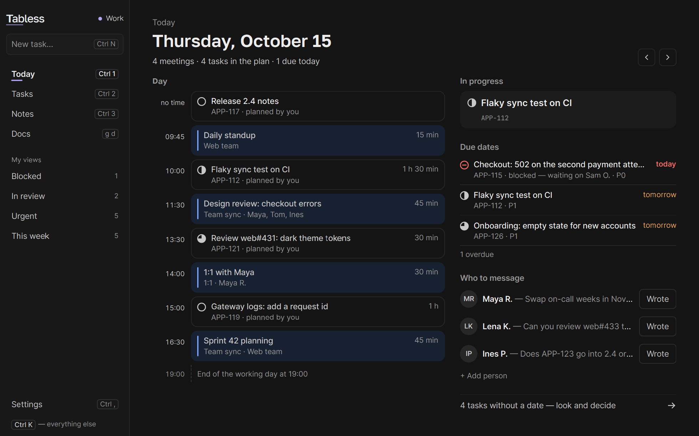
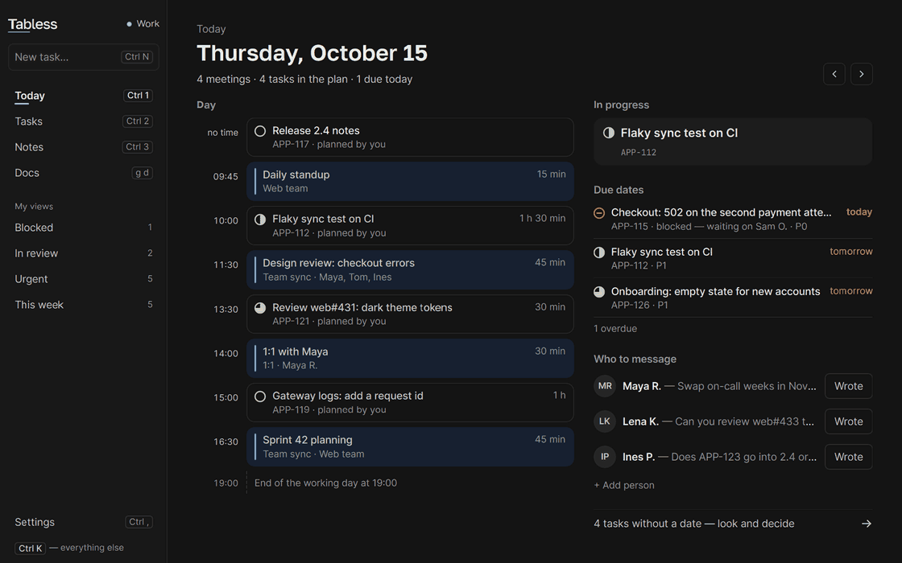
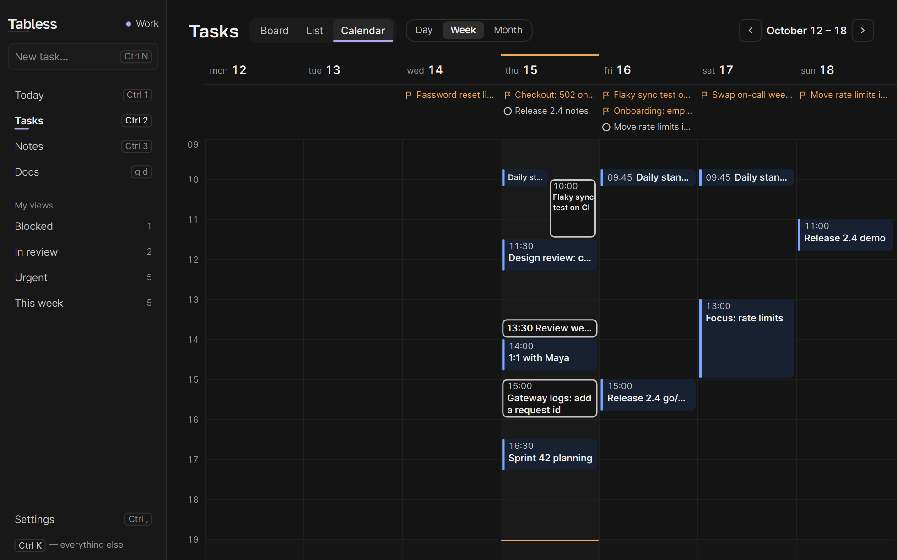
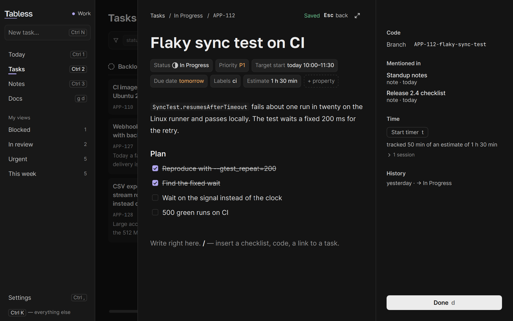
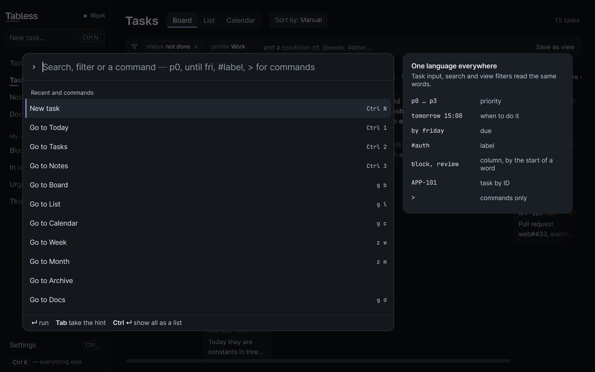
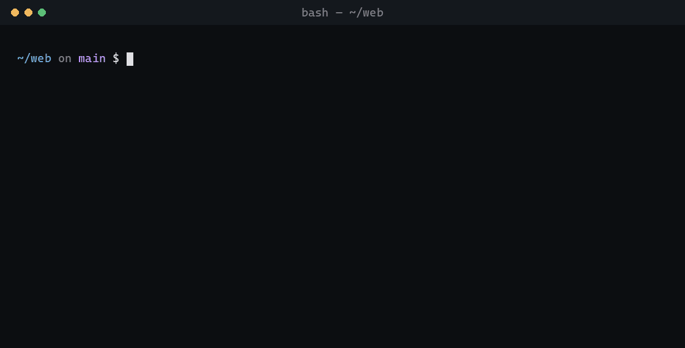

<p align="center">
  <picture>
    <source media="(prefers-color-scheme: dark)" srcset="design/brand-export/tabless/tabless-wordmark-on-dark.svg">
    
  </picture>
</p>

<h3 align="center">Just makes your day easier.</h3>

<p align="center">A developer’s workday in one window</p>

<p align="center">
  <a href="https://github.com/sectapunterx/tabless/releases/latest"><b>Download</b></a> ·
  <a href="https://tabless.dev/">The tour on the website</a> ·
  <a href="#docs">Docs</a>
</p>

<p align="center">
  
</p>

<p align="center">
  <a href="https://github.com/sectapunterx/tabless/releases"></a>
  <a href="LICENSE"></a>
  
</p>

- **Your tracker tasks, one list** — GitHub, GitLab, Jira, Trello, Gitea, Forgejo, Redmine, Todoist, Asana,
  ClickUp, Sentry, Bitbucket, plus Mattermost for @mentions. Read-only unless you switch writes on.
- **Capture from any app** — `Ctrl+Shift+Space`, type `Review PR tomorrow 10:00 p1 #api`, done.
- **Knows your branch** — check out `APP-112-…` and APP-112 is at the top of the window.
- **Vim-style keys** — `j` `k`, `g b`, `d`, `/`; any layout, every key rebindable.
- **Yours, on disk** — one readable `state.json`. No account, no analytics, works offline. Free, MIT.

<p align="center">
  
  <br><sub>Moving around on <code>g</code> keys, then quick capture turns one line into a task on Friday at 10:00</sub>
</p>

## Up and running in two minutes

1. **Install** — from [the latest release](https://github.com/sectapunterx/tabless/releases/latest): Windows
   `setup.exe` or portable `.zip`, macOS `.dmg`, Linux `.AppImage` (Qt inside, nothing else to install).
   Or `scoop bucket add tabless https://github.com/sectapunterx/tabless` then `scoop install tabless` on Windows,
   `brew install --cask sectapunterx/tabless/tabless` on a Mac.
2. **Connect a tracker** — Settings → Integrations → **Connect with browser**. A token works everywhere too.
3. **Add your calendar** — paste an `.ics` link from Outlook, Google or iCloud. Read-only.
4. **Press `?`** — every key on one screen.

**Coming from lowkey or heap?** Same app, new name. On the first start your data folder is copied over
once — tasks, notes, settings, backups, snapshots and tracker tokens, so nothing needs signing in again.
The old folder stays where it was, with a `MOVED-TO-TABLESS.txt` note inside.

<details>
<summary><b>Windows or macOS warns you on first launch?</b></summary>
<br>

The builds are not signed with a paid certificate yet: a free signing service for open-source projects
turned the application down, and the Apple developer fee is not covered yet. The warning has nothing to do
with the code itself.

- **Windows** — SmartScreen says "Windows protected your PC": click **More info → Run anyway**. Installing
  with Scoop skips the download prompt in the browser.
- **macOS** — the app is ad-hoc signed but not notarized: right-click it in Applications → **Open**. On
  macOS 15 and later, open it once, then go to **System Settings → Privacy & Security → Open Anyway**.

Every release ships `SHA256SUMS` and an SBOM next to the files, the in-app updater refuses a file whose
checksum does not match, and you can [build it yourself](docs/BUILDING.md).
</details>

## A day with it

**Morning.** Today shows the meetings and tasks of the day by the hour, plus what is in progress and due.
The week puts the meetings and the planned work side by side.

<p align="center">
  
  <br><sub>Week — meetings and planned tasks side by side</sub>
</p>

**A thought mid-call.** `Ctrl+Shift+Space` over any app. Date, time, priority and label are read from the
words, in English or Russian. `Ctrl+Shift+N` does the same for a note.

**Starting work.** Check out the ticket's branch — the task shows up top with its PR state from your own
`gh` or `glab`, and moves to In Progress (one switch turns that off).

<p align="center">
  
  <br><sub>Board — your tasks by status, one keypress per move</sub>
</p>

**Your own layer on every ticket.** Private notes, checklist, tags and dates on any tracker task. A sync
never overwrites them, and none of it goes back to the tracker.

<p align="center">
  
  <br><sub>A task opens as a document — plan, code, history</sub>
</p>

**Notes that point at work.** `#APP-112` in a note becomes a link with the task's title. Bring an existing
folder of `.md` files or an Obsidian vault — you see what comes in before anything is copied.

<p align="center">
  
  <br><sub>Notes — Markdown linked to tasks</sub>
</p>

## It never does these without asking

| | |
| --- | --- |
| **Write to your tracker** | Issues come in read-only. Status on card move is a per-tracker switch, off by default, and the issue is re-checked before anything is sent. Titles, descriptions and comments are never written. |
| **Phone home** | No analytics. After a crash the app offers a report you read first and send yourself as a GitHub issue; it never sends one on its own. The update check on start can be turned off; updates install only on your click. |
| **Run in the background** | Only while its window or tray icon is open. Start at login is off. |
| **Lose your work** | Daily backups (newest 20 kept) and a time machine of snapshots you can step back through. |

<p align="center">
  
  <br><sub>The Quiet style — the same day, less on screen</sub>
</p>

## Built for the keyboard

| Key | Does |
| --- | --- |
| `Ctrl+K` | Find anything, run any command |
| `Ctrl+1` `2` `3` | Today · Tasks · Notes |
| `g b` · `g l` · `g c` | Board · list · calendar |
| `j` `k` · `h` `l` | Move the cursor |
| `d` · `s` | Done · schedule |
| `y y` · `y b` | Copy task id · branch name |
| `/` | Filter the section you are in |

Keys are read by their place on the keyboard, so they work in any layout. Full map:
[docs/HOTKEYS.md](docs/HOTKEYS.md).

The filter is a small query language — same in board, list and calendar:

```
status:blocked  due:week  is:overdue  priority:p0,p1  branch:login  estimate:>2h  -status:done  bug OR crash
```

<p align="center">
  
</p>

## And from the terminal

See what you're on or note a task without leaving the shell. `tabless now` prints the task your branch names,
or the one with a running timer, so it can sit in your prompt.

<p align="center">
  
  <br><sub>Today's list, a task in one line, and the branch's task in the prompt</sub>
</p>

Changes show up in the open window at once. On Windows the command is `tabless-cli`. Starship snippet and
the rest: [docs/CLI.md](docs/CLI.md).

## Not for you if

- you need a shared team board — this is your desk, the team's tracker stays the shared place;
- you want something to plan your day for you — it shows the facts, the decisions stay yours;
- you need live sync between machines — for now it is export and import;
- you work from a phone — there is no mobile or web version.

## Docs

- [Keyboard](docs/HOTKEYS.md) — every key, and how to rebind them
- [Trackers](docs/INTEGRATIONS.md) — connecting each one; what is read, what may be written ·
  [Add your tracker](docs/ADD_A_TRACKER.md)
- [Data and backups](docs/DATA.md) — where files live, restores, moving between machines
- [Command line](docs/CLI.md) · [Tutorial](docs/TUTORIAL.md)
- [Building from source](docs/BUILDING.md) — Qt 6.9+, C++20 · [Contributing](CONTRIBUTING.md)

Bug reports and pull requests are welcome — please attach `logs/tabless.log`.

MIT — see [LICENSE](LICENSE). Bundled fonts (Inter, Golos Text, JetBrains Mono) are under the SIL OFL 1.1, see
[THIRD_PARTY_NOTICES.md](THIRD_PARTY_NOTICES.md).
